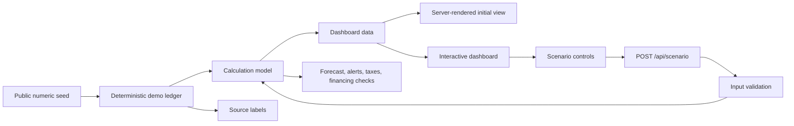

# Weekmark Household Lab

I built Weekmark to test a practical household planning dashboard with
synthetic data. It helps answer four questions:

1. What is safe to spend before the next planning point?
2. When could operating cash get tight over the next 13 weeks?
3. Is enough variable income being reserved for taxes?
4. Does a financing quote fit the budget and meet basic quality checks?

[View the live demo](https://weekmark-household-lab.charlielucas95.chatgpt.site)

All amounts, names, obligations, events, and trends are fictional. The public
seed in `lib/seed.ts` reproduces the same data on every run.

## Run it locally

This project requires Node.js 22.13 or newer.

```bash
npm install
npm run dev
```

Open the local URL printed by the development server. You can choose a preset,
adjust income and spending assumptions, run the scenario, inspect the cash
forecast, review alerts, or compare financing terms.

Use these commands to check the project:

```bash
npm run lint
npm run typecheck
npm test
npm run build
npm audit --audit-level=high
```

## What is included

- A weekly spending limit, upcoming commitments, fixed costs, and a cash
  forecast covering 13 weeks
- Alerts for cash, taxes, spending behavior, events, and financing choices
- A breakdown of reliable income, variable income, tax reserves, obligations,
  spending, financing, and remaining margin
- A calendar of recurring bills with due dates and confidence labels
- Financing checks for rate type, prepayment penalties, fees, payment room, and
  the projected cash floor
- Twelve months of synthetic trends for income, spending, assets, and
  liabilities
- Source and confidence labels that distinguish seeded data, current inputs,
  and calculated results
- Keyboard support, chart tables, reduced motion support, responsive layouts,
  and a print view

## How it works



The server calculates the initial page. Scenario changes go to the same-origin
API, which validates the inputs and runs the same calculation model. The app
does not save those values. Visitors should still use hypothetical inputs
because the API is hosted.

See [Architecture](docs/ARCHITECTURE.md) for the module boundaries and design
decisions.

## Data and privacy

`createDemoLedger()` uses a fixed integer seed and a small deterministic random
number generator. It does not read the current time, browser storage, local
files, network services, environment variables, or external accounts.

The data model has no fields for:

- merchants, payees, transactions, memos, or imported statements
- account numbers, routing numbers, access tokens, or credentials
- real household names, employers, addresses, or financial institutions

Tests check the generated data and source code for restricted field names,
identifier patterns, personal file paths, runtime secrets, and direct remote
data access. See the [Privacy threat model](docs/PRIVACY_THREAT_MODEL.md) for
the full boundary.

## Calculations

Full definitions and limits are documented in
[Metrics and formulas](docs/METRICS.md).

### Spendable and protected cash

```text
spendable cash = operating cash
protected cash = tax reserve + health reserve
```

Protected cash is shown separately and left out of the operating cash forecast.

### Variable income

```text
variable tax reserve = variable gross * selected reserve rate
variable usable = variable gross - variable tax reserve
usable monthly income = reliable net + variable usable
```

### Cash forecast

```text
ending cash[w] = ending cash[w-1]
               + modeled income[w]
               - calendar obligations[w]
               - weekly spending limit
               - known one-time events[w]
               - weekly financing payment
```

### Financing quote

```text
financed amount = requested proceeds / (1 - origination fee rate)
monthly payment = standard fixed-rate amortization payment
financing cost = monthly payment * term - requested proceeds
```

These checks are planning heuristics. They are not underwriting, tax advice, or
financial advice.

## Testing and accessibility

The test suite covers deterministic data generation, input validation, cash
forecast reconciliation, scenario changes, amortization, financing checks, API
headers, and privacy checks.

GitHub Actions runs the dependency audit, lint, type checking, tests, and
production build. Dependabot checks npm and GitHub Actions dependencies each
week.

Accessibility work includes semantic landmarks, a skip link, visible keyboard
focus, labeled controls, chart tables, reduced motion support, responsive
layouts, and a print mode. The manual checklist and current gaps are in
[Accessibility](docs/ACCESSIBILITY.md).

## Limits

- The project uses synthetic data and has not been connected to a bank,
  budgeting tool, payroll system, or tax return.
- The cash forecast assumes reliable income every two weeks and spreads
  variable income evenly across each week.
- Recurring obligations do not model statement changes, late fees, or partial
  payments.
- The tax reserve is a planning estimate, not a tax calculation.
- Financing calculations assume a fixed payment schedule and on-time payments.
- Scenario changes and acknowledged alerts are not saved.
- The app has no authentication because it has no private or live data.

## Documentation

- [Architecture](docs/ARCHITECTURE.md)
- [Metrics and formulas](docs/METRICS.md)
- [Privacy threat model](docs/PRIVACY_THREAT_MODEL.md)
- [Accessibility](docs/ACCESSIBILITY.md)
- [Interface system](docs/DESIGN_SYSTEM.md)

## License

No open source license has been selected. This public portfolio project is
available for review, but reuse rights are not granted.
